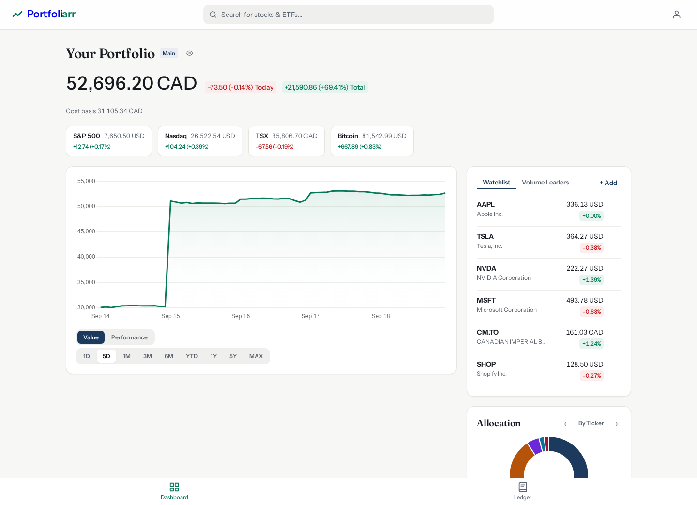
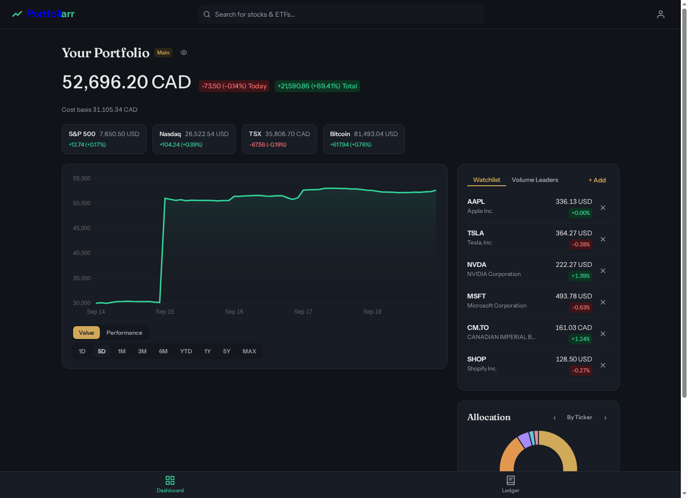
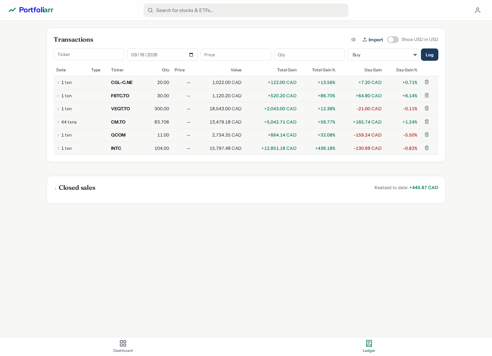
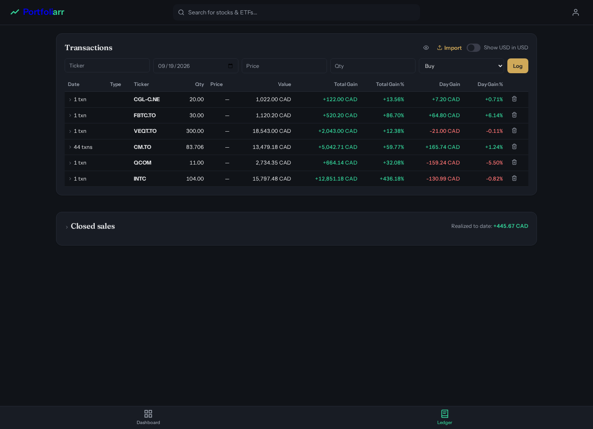
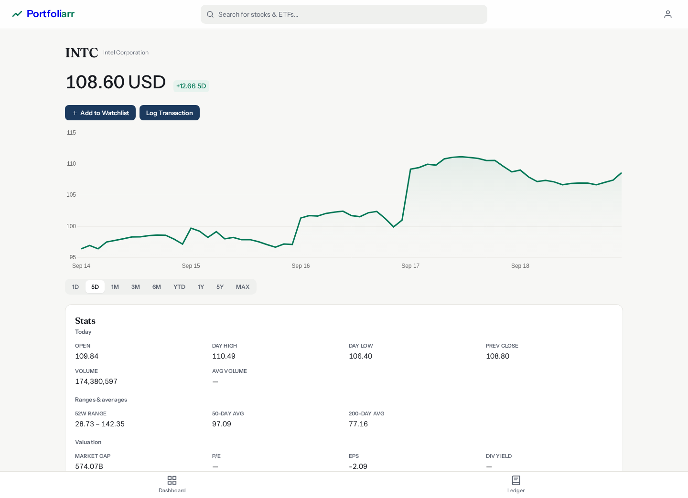
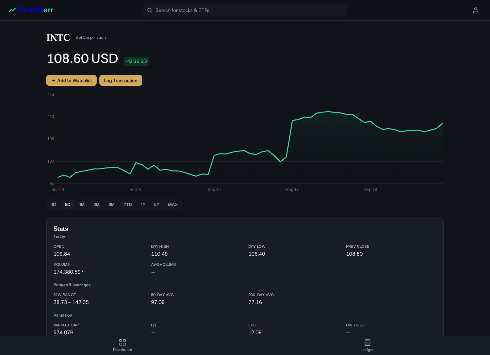
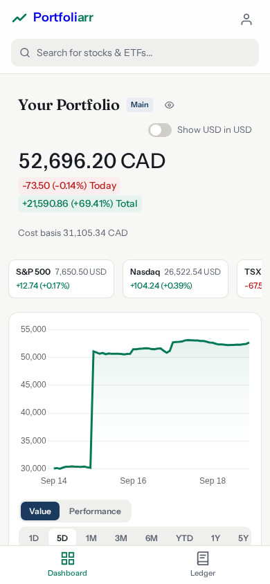
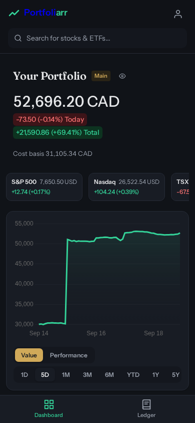

# Portfoliarr

A personal stock and ETF portfolio tracker. Search any ticker Yahoo Finance knows, log buy and sell transactions, and watch your holdings grow — current value, unrealized profit/loss, a portfolio-value-over-time chart, and an allocation breakdown.

Prices and data come from [Yahoo Finance](https://finance.yahoo.com/) through the [yfinance](https://github.com/ranaroussi/yfinance) library. Portfolio views display in Canadian dollars by default; the watchlist and stock pages stay in each security's native currency.

## Dashboard

- Markets today: six category tabs (North America, Europe, Asia-Pacific, Crypto, Commodities, Currencies) over one divided strip of live instruments
- Value summary strip: total value, day change, total return, cost basis
- Portfolio-value-over-time line chart, with a time-weighted Performance (TWR) view
- Allocation donut carousel by ticker, sector, country, type, cap bucket, and currency
- Watchlist and volume-leaders sidebar, and ticker search bar
- Privacy eye toggle to hide the amounts




## Ledger

- Buy/sell transaction log with grouping, sorting, editing, and paste import, showing quantity, value, total gain, and day gain per ticker
- Closed Sales table showing each sale's realized result in CAD (average-cost basis)
- "Show USD in USD" display toggle for the ledger rows
- Privacy eye toggle to hide the amounts




## Stock detail

- Large live price display
- Time-segmented chart: 1D · 5D · 1M · 3M · 6M · YTD · 1Y · 5Y · MAX
- Stats grid: open, high, low, prev close, volume, 52-week range, market cap
- Buttons to add to the watchlist or log a transaction




## Mobile

The dashboard at phone width with the same bottom tab bar that links Dashboard and Ledger.




## Preferences

- Theme: light, dark, or follow the system
- Show closed positions: keep fully-sold tickers visible in the ledger
- Default ledger sort column and direction

## Tech stack

| Layer | Tool |
|---|---|
| Backend | Python 3.14 + [Flask](https://flask.palletsprojects.com/) (serves JSON; the browser renders) |
| Frontend | HTML (Jinja2), vanilla JavaScript, [Chart.js](https://www.chartjs.org/) |
| Database | [SQLite](https://www.sqlite.org/) (lives in the ignored `instance/` folder) |
| Price feed | [yfinance](https://github.com/ranaroussi/yfinance) |

## Quick start (development)

```bash
source .venv/bin/activate          # create it first with python -m venv .venv
pip install -r requirements.txt   # versions are pinned
python app.py                     # dev server on http://localhost:5000
```

The development server listens on `127.0.0.1:5000`. To turn on the debugger for local development, set `PORTFOLIARR_DEBUG=1`.

## Tests

```bash
python -m pytest
```

The suite runs against a fake market and a throwaway database — no network, no real ledger. The first run warms up pandas/numpy and can take ~90 seconds; steady state is ~17 seconds.

## Run with Docker

Only on a server; the dev machine has no Docker. CI publishes `ghcr.io/christopheawad/portfoliarr:latest` on every green push to `main`.

```bash
docker compose pull && docker compose up -d
```

- App URL: `http://localhost:9967`
- The `portfoliarr-data` volume keeps the SQLite ledger across updates
- Server timezone is pinned to `America/Toronto`
- Gunicorn runs one process with eight threads (caches and SQLite require it)

This deployment uses plain HTTP. Use it on a trusted private LAN, do not forward the port to the internet, and finish first-run setup before allowing other devices to connect.

The account security upgrade signs everyone out once and turns off legacy open signup. The installation owner manages accounts and shared fund classifications. See the [upgrade and recovery runbook](docs/operations/audit-rollout.md) for backups, owner recovery, and password resets.

## Local performance telemetry

To start collecting measurements, sign in as the server owner and turn on
**Preferences → Performance → Collect local telemetry**. The switch starts off.
It takes effect without a restart. Open Dashboard or Ledger to collect the
first load timings. The weekly report also counts save and paste import requests
and their outcomes. It counts received measurements, not people.

The switch applies to all signed-in accounts on this installation. Only the
owner can see the weekly report. The measurements include no account names,
IP addresses, tickers, portfolio values, trades, or pasted text. Portfoliarr
does not send them outside the server.

Measurements live in `instance/telemetry.db`, or `/app/instance/telemetry.db`
in Docker's `portfoliarr-data` volume. The report shows the last seven days.
Each write removes measurements more than 30 days old and keeps at most 20,000
rows. Turning collection off stops new writes but does not delete the file.
Recent measurements can appear again if you turn it back on. A copy of
`portfolio.db` includes the setting only; a backup of the whole volume can
include the measurements as well.

To delete the measurements on a Docker server, turn the switch off first.
Then run these commands beside the Compose file:

```sh
docker compose stop portfoliarr
docker compose run --rm --no-deps --entrypoint /bin/rm portfoliarr -f /app/instance/telemetry.db /app/instance/telemetry.db-journal /app/instance/telemetry.db-wal /app/instance/telemetry.db-shm
docker compose up -d
```

Keep `portfolio.db` and the Docker volume. They hold your portfolio and accounts.

## Android app

`android/` holds a thin WebView client for this web app. Build with `./gradlew assembleDebug` (JDK 17, Android SDK 34). See `android/README.md`.

On the first app open after you sign in, Portfoliarr offers to unlock with your fingerprint or phone PIN instead. If you say yes, every cold start asks for it and opens your portfolio with no typing; if you cancel, your password works exactly as before, and the app offers to stop asking or to forget the phone. There is no WebAuthn/passkey support: that needs HTTPS and a real domain name, which a plain-HTTP LAN server does not have.

The app updates itself from GitHub Releases. The first APK signed with the new production key needs a one-time uninstall and reinstall. See the [Android release instructions](android/README.md#first-release-with-the-private-key). Later updates can install in place and still need Android's final Install tap. Shipping requires a version bump and a manual publish from `main`.

## Scope

Multi-user, with sign-in required: each person owns their own portfolios, transactions, and watchlist. Not included by design: dividends, cash-balance tracking, currencies beyond USD/CAD, and news/AI/social features.
