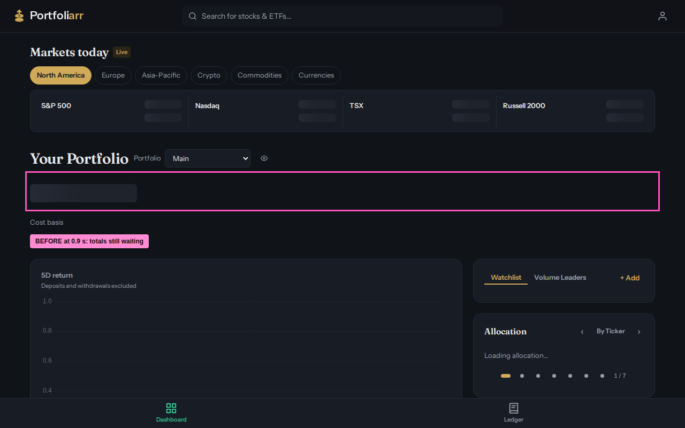
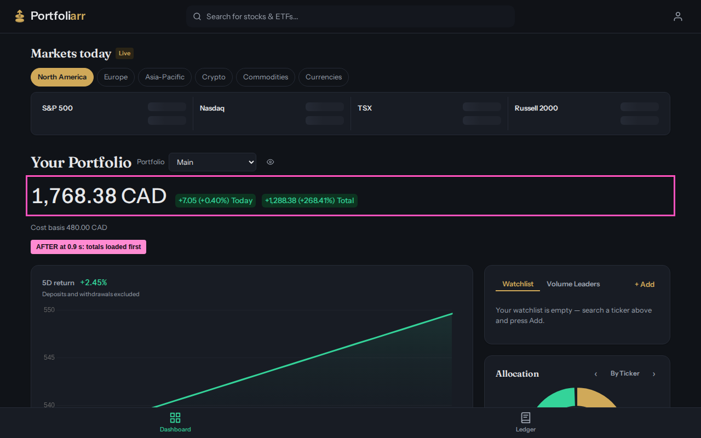
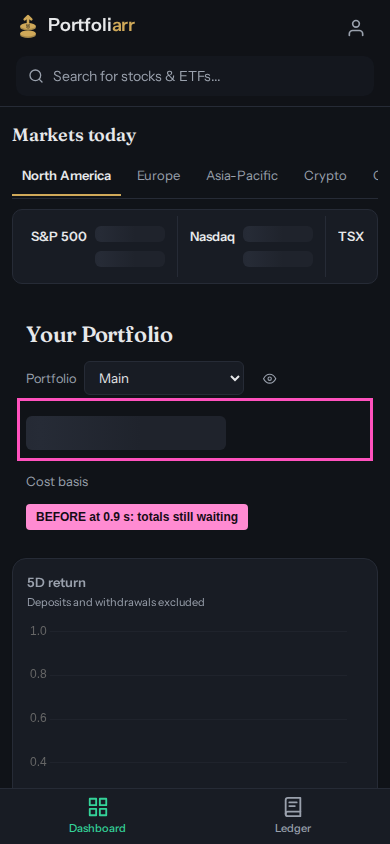
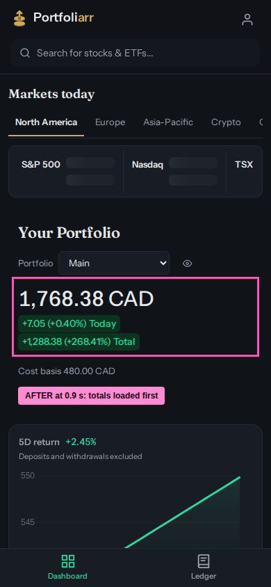

# Dashboard first-load request order

## Cause and fix

The dashboard started six market-category requests, the watchlist, and Volume
Leaders before requesting the portfolio summary and visible chart. On HTTP/1,
Chromium's six connections to one origin could all be occupied by market
requests. The portfolio summary then waited in the browser before reaching
Flask. The production image uses one Gunicorn worker with eight threads.

The dashboard now starts the active market category and watchlist immediately.
Once the portfolio list resolves, it starts the summary and visible chart
before the other five market categories and Volume Leaders. It does not wait
for either portfolio response before starting those background requests. All
six market tabs still preload automatically, share pending reads, and reuse
recent results. The normal poll still refreshes only the active market tab.

The tradeoff is that hidden market tabs and Volume Leaders can finish later.
This fix removes avoidable queue time; it does not reduce provider work or
make an uncached Yahoo request faster. Quotes still expire after 120 seconds.

## Controlled browser measurement

Baseline: `0ca8f8f`. The after measurement serves the actual modified
`static/js/main.js`, without rewriting its response.

The probe uses Chromium, HTTP/1, and the production Gunicorn configuration of
one worker and eight threads. It creates a disposable database with two BUY
transactions, AAPL and RY.TO, plus an empty second portfolio. Each market
function takes a fixed 150 ms. An additional two-second delay affects only
market-category and Volume Leaders requests. Both variants use a fresh
browser context. This stub bypasses real market caches, so the result measures
request scheduling, not Yahoo or cache performance.

| Measurement | Before | After |
|---|---:|---:|
| Desktop summary render mark, 1280x800 | 2664 ms | 485 ms |
| Desktop summary browser queue | 2156 ms | less than 1 ms |
| Desktop summary server time | 303 ms | 302 ms |
| Phone summary render mark, 390x844 | 2620 ms | 462 ms |
| Phone summary browser queue | 2137 ms | less than 1 ms |
| Phone summary server time | 304 ms | 302 ms |

Queue time is Resource Timing `requestStart - startTime`. Server time comes
from `Server-Timing`. The summary render mark follows the real DOM updates;
it is not a physical display-presentation measurement. Each page made one
summary request, one default 5D history request, six market-category requests,
and one Volume Leaders request. No browser errors, failed requests, HTTP error
responses, or unexpected server errors occurred.

These are controlled local measurements, not deployed-server or Android-device
measurements. A separate new-process live Yahoo probe took 518-735 ms for
AAPL, RY.TO, and USDCAD=X; their next cache reads each took less than 1 ms.
Those live times are individual observations, not a performance guarantee.

The disposable probe and raw report on the audit host are
`/tmp/opencode/portfolio_startup_probe.py`,
`/tmp/opencode/portfolio_startup_probe_app.py`, and
`/tmp/opencode/portfolio-startup-verified.json`. Run the probe with
`/usr/bin/python3 /tmp/opencode/portfolio_startup_probe.py`. It uses the main
checkout's existing Python environment and does not read the real ledger.

## Screenshots

Both screenshots in each pair were taken at approximately 0.9 seconds after
navigation, with the same controlled provider delays and synthetic holdings.
Pink outlines and labels mark the changed loading result. These annotations
exist only in the screenshot pages.

| Before | After |
|---|---|
|  |  |
|  |  |

## Verification

- The new behavior tests failed on the original startup order, then passed
  after the fix. They cover priority order, a pending portfolio list, privacy
  masking at boot, unresolved portfolio responses, empty/failed list recovery,
  portfolio switching, one initial summary/default-chart call, and
  active-tab-only polling.
- The existing market preload tests continue to cover sharing, expiry,
  response-order guards, keyboard behavior, and HTTP/network/JSON failures.
- Full local suite: **1658 passed in 119.42 seconds**, with no skips.
- `node --check static/js/main.js` and `git diff --check` passed.
- The main checkout's unchanged `.venv` was reused. Tests redirected the
  database before importing the application. No separate frontend build,
  lint, or type-check command exists.
- Final post-review GUI actions and independent PR review are pending.
- No pull-request CI workflow or protected required check is configured.
  The existing main-only Docker workflow must test, build, smoke-test, and
  publish the merged commit before the image is ready to use.
